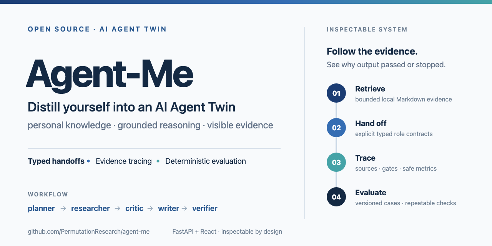
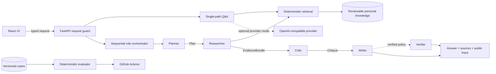

<div align="center">

# Agent-Me

### Own your agent traces. Improve your stack.

Agent-Me helps people extract and own their AI-agent work history, optionally sell selected traces to us, and use that evidence to improve the stack they work with.

The product direction combines open-source data extraction, GEPA prompt and skill optimization, custom agent harnesses, and training smaller models for a person's needs.

**Turn your agent experience into portable data and measurable improvements.**

[Public deployment](docs/PUBLIC_LAUNCH.md) · [Submit and review](docs/SUBMISSIONS.md) · [Trace studio](#trace-extraction-and-export) · [Quick start](#quick-start) · [Roadmap](ROADMAP.md) · [Architecture](docs/ARCHITECTURE.md) · [Learn](LEARN.md) · [Contribute](CONTRIBUTING.md)

<p>
  <a href="https://github.com/jzjzzzzzzz/agent-me/actions/workflows/ci.yml"></a>
  <a href="https://github.com/jzjzzzzzzz/agent-me/releases"></a>
  
  
  <a href="LICENSE"></a>
</p>

[English](README.md) · [简体中文](docs/i18n/README.zh-CN.md) · [All languages](docs/LOCALIZATION.md)

</div>



## Trace extraction and export

Open **Trace studio** in the app navigation or visit `/traces`. It works without
an account, backend, or connected archive. Choose local Claude Code, Codex,
OMP/Pi, agent-trace, or normalized trace files; review redacted records; edit or
exclude sensitive content; and export only the records you select.

Exports are portable JSON packs with source roles, provenance, and integrity
checks. Choose a personal copy or a draft offer to Agent-Me with use preferences.
Nothing is uploaded and no sale or payment is completed by exporting. See
[Trace extraction and export](docs/TRACES.md) for supported formats and limits.

The homepage at `/` now leads into this flow. Use `/submit` for exported sale-offer
packs, `/submissions` for private receipts, and `/buyer` for the operator inbox.
Run `python3 scripts/start_trace_market.py` to start the separate local review
service at `http://localhost:5181/`. See [Submissions](docs/SUBMISSIONS.md) for the
private buyer-key location and encrypted-storage option. The original agent demo
remains at `/workspace`.

## What is Agent-Me?

Agent-Me is a platform for turning agent traces into user-controlled data and better agent systems.

```text
extract traces → review and package → keep, export, or offer for sale
                                  ↓
                      evaluate the user's stack
                                  ↓
          optimize prompts and skills / build a harness / train a small model
                                  ↓
                  compare results → deliver portable improvements
```

People can use open-source extraction to obtain their own data. Selling selected trace packs to us is optional. Their history can also support a personalized harness, better prompts and skills, or a smaller model adapted to their work.

The current implementation provides a FastAPI + React foundation, an opt-in private workspace, verified archive retrieval, and a local GEPA optimization flow. Browser-local trace review and selected-only export are implemented. Selected-pack submission, private receipts, buyer review, and priced proposals are implemented in a separate local intake service. Accepted proposals remain pending agreement and payment. Purchasing, final licenses, harness generation, and small-model training remain planned work. The owner's large archive import is a separate operation and must finish verification before it can be used.

See [Product vision](docs/PRODUCT_VISION.md) for the core direction and the [roadmap](ROADMAP.md) for the implementation priorities. A personal AI Twin is one application of this platform.

## AI Twin as one application

Many personal chatbots are effectively a prompt, a vector database, and a chat interface. They can recall biographical facts or imitate a writing style, but that is not the same as reliably representing a person.

> Remembering facts about a person is easy.<br>
> Building a system that can reliably represent that person is much harder.

The deeper question behind Agent-Me is: **what would it take for an AI to actually represent a person?** Such a system needs more than recall. It needs durable identity and memory models, provenance, temporal updates, uncertainty, reasoning, verification, and user control.

Agent-Me does not claim to solve all of those problems today. It provides a concrete, testable architecture for exploring them without hiding the process behind a single model response.

## Why Agent-Me is different

### Reviewable identity and memory

The current memory substrate is version-controlled Markdown: small, explicit, and inspectable. It gives the twin a stable body of personal knowledge instead of treating every conversation as isolated. An optional private workspace adds SQLite-backed typed memory, reviewed identity/relationships, declared valid and event times, revision history, persisted chat transcripts, and owner-confirmed learning. A browser review workbench makes approved-source ingestion, conflict review, provenance and local evidence-grounded answers accessible without the CLI. Optional [scoped model-assisted extraction](docs/SEMANTIC_LEARNING.md) proposes pending classifications over exact source quotations; unconstrained semantic inference remains future work. Its workbench/API and [explicit-file CLI](docs/SEMANTIC_LEARNING.md#explicit-file-local-cli) require separately reviewed disclosure scope and per-attempt consent.

### Evidence-grounded responses

Retrieved personal knowledge remains connected to exact source excerpts. The system can refuse synthesis when it has insufficient evidence rather than filling gaps with confident invention.

### Multi-agent reasoning

Planner, Researcher, Critic, Writer, and optional Verifier roles have separate responsibilities and communicate through typed Python contracts. The goal is not to maximize the number of agents; it is to make important decisions explicit and testable.

### Inspectable execution

Agent-Me exposes a public execution trace: role outcomes, safe intermediate summaries, evidence, metrics, retrieval activity, and verification results. It does **not** expose or claim to expose a model's private chain-of-thought.

### Verification and evaluation

Before an answer is returned, implemented checks can validate citation paths, evidence policy, and output invariants. Versioned cases then test supported, unsupported, adversarial, and boundary requests deterministically.

> Most AI assistants show you only:
>
> `prompt → answer`
>
> Agent-Me exposes the system in between:
>
> `memory → retrieval → planning → evidence → critique → verification → answer`

**Because if an AI is going to represent you, you should be able to inspect why it speaks for you.**

## How it works

| Part | Role in the AI Twin | Current implementation |
| --- | --- | --- |
| Personal knowledge | Represents what the twin knows | Reviewable, version-controlled Markdown |
| RAG | Finds relevant personal evidence before answering | Bounded deterministic local retriever |
| Planner | Decides how to approach a question | Typed plan artifact |
| Researcher | Collects evidence for the plan | Exact source excerpts and metadata |
| Critic | Challenges unsupported synthesis | Evidence-sufficiency gate |
| Writer | Produces the grounded response | Citation-aware answer artifact |
| Verifier | Prevents invalid output from passing | Optional citation-path and metadata checks |
| Public trace | Makes execution inspectable | Safe stage summaries, outcomes, and metrics |
| Evaluation | Measures behavior beyond a demo | Versioned fixtures and deterministic runner |

The opt-in personal Agent additionally implements evidence-linked relationships, structured memory, typed know/recommend/act routing and three owner-approved local task/note tools. The [action workbench](docs/AGENCY_WORKBENCH.md) exposes their default-off permissions, independently reviewed plans/approval/execution, local outputs and exact-effect undo. Arbitrary external tool integrations and unconstrained semantic inference remain future work; see the [implementation ledger](docs/AGENT_IMPLEMENTATION.md) and [private workspace guide](docs/PERSONAL.md).

## Architecture

**Agent-Me treats an AI Twin as a system, not a prompt.**



The baseline policy executes Planner → Researcher → Critic → Writer. The verified policy adds Verifier as a fifth stage. Frozen dataclasses define the `Plan`, `EvidenceBundle`, `Critique`, `WrittenAnswer`, and `Verification` handoffs. Both policies run sequentially in one process against the same bounded retriever.

> [!NOTE]
> The Verifier checks citation paths and other implemented output invariants. It does not prove factual truth or semantic entailment. See [Trust, Data Flow, and Deployment Boundaries](docs/TRUST.md) for the complete system boundary.

Read [System Architecture](docs/ARCHITECTURE.md) for request paths and contracts, and [API Reference](docs/API.md) for endpoint schemas.

## Inspect a run

Run the five-stage verified workflow:

```bash
curl http://localhost:8000/api/v1/collaborate \
  -H 'Content-Type: application/json' \
  -d '{"question":"How does the example agent plan a project?","workflow":"verified"}'
```

| Field | What it lets you inspect |
| --- | --- |
| `workflow` | Selected four- or five-stage policy |
| `sources` | Exact excerpts available to the roles |
| `grounded` | Whether the implemented evidence policy passed |
| `trace` | Role, outcome, safe summary, and metrics for each stage |
| `run_id` | Server-generated execution identity |

When evidence is missing, the Critic blocks synthesis and the Writer returns a fixed insufficient-evidence response. In verified mode, invalid citation paths or citation-count metadata are blocked as well.

## Evaluation

The checked-in fixtures cover supported, unsupported, adversarial, and boundary requests. Results are deterministic for the same code, corpus, workflow, and input.

```bash
make test
make evaluate
make evaluate-semantic # Validate authored semantic benchmark labels; no model call/score
.venv/bin/python scripts/evaluate_collaboration.py --workflow verified --json
```

The default evaluator reports `COLLABORATION_EVAL 4/4 passed`. CI also runs backend tests, frontend lint/typecheck/tests/build, documentation validation, both workflow policies, and container smoke tests. See [Lesson 06](course/06-evaluation/README.md) and the [evaluation fixtures](course/fixtures/collaboration_cases.json).

## Quick start

### Docker Compose

**Requirement:** Docker with the Compose plugin.

```bash
git clone https://github.com/jzjzzzzzzz/agent-me.git
cd agent-me
# Preserve any existing .env configuration.
if [ ! -e .env ]; then cp -n .env.example .env; fi
docker compose up --build
```

| Service | URL |
| --- | --- |
| Web application | <http://localhost:5173> |
| Interactive API docs | <http://localhost:8000/docs> |
| Health | <http://localhost:8000/health> |
| Readiness | <http://localhost:8000/ready> |

The default configuration uses local extractive and collaboration modes, so no API key is required. The web container reaches the API through a same-origin `/api` gateway.

### Optional OrcaRouter provider

Agent-Me's provider path uses the OpenAI-compatible Chat Completions API, so it can connect to
[OrcaRouter](https://www.orcarouter.ai/ref/ref_a8d28bcd0c266af4ae1c) without a provider-specific
SDK. Create an OrcaRouter API key, then set the following values in your private `.env`:

```dotenv
LLM_BASE_URL=https://api.orcarouter.ai/v1
LLM_API_KEY=sk-orca-YOUR_KEY
LLM_MODEL=orcarouter/auto
```

Restart the API and check `/ready`; `answer_mode` should report `openai-compatible`. Only
`POST /api/v1/chat` uses the provider today. It sends the question, recent chat history, and
retrieved context across that provider boundary. `POST /api/v1/collaborate` remains local and
deterministic. See the [trust documentation](docs/TRUST.md) before using private knowledge.

<details>
<summary><strong>Run with the local toolchain</strong></summary>

**Requirements:** Python 3.11+, `uv` 0.11 or 0.12, Node.js 22+, npm, and Git.

```bash
git clone https://github.com/jzjzzzzzzz/agent-me.git
cd agent-me
make setup
make knowledge-check
make lint test docs evaluate
```

Start the services in separate terminals:

```bash
.venv/bin/uvicorn app.main:app --app-dir backend --reload
```

```bash
cd frontend && npm run dev
```

See [Lesson 00](course/00-course-setup/README.md) for platform-specific setup and troubleshooting.

`make knowledge-check` safely preflights the configured Markdown corpus before startup. It reports
only the document count and relative paths, never document contents or absolute host paths. Use
`.venv/bin/python scripts/check_knowledge.py --knowledge-dir knowledge --json` for a stable
machine-readable result.

</details>

## Build your own AI Twin

1. Replace [`knowledge/example-profile.md`](knowledge/example-profile.md) with reviewed Markdown you are allowed to use.
2. Configure `APP_NAME` and `APP_DESCRIPTION` in your private `.env`.
3. Add supported, unsupported, adversarial, and boundary evaluation cases.
4. Extend typed artifacts and update the Python and TypeScript contracts together.
5. Configure an OpenAI-compatible provider only when its data-processing boundary is acceptable.

Key implementation entry points:

```text
backend/app/collaboration.py        role contracts and orchestration
backend/app/knowledge.py            bounded deterministic retrieval
backend/app/main.py                 FastAPI routes and public metadata
frontend/src/                       React client and strict response parsing
course/fixtures/                    versioned behavioral cases
scripts/evaluate_collaboration.py   deterministic evaluator
```

## Learn by rebuilding Agent-Me

The repository also includes a bilingual engineering curriculum that walks through the architecture from retrieval and evidence to multi-agent orchestration and verification. It is an educational layer around the working system, not the definition of Agent-Me itself.

Start with the [English syllabus](course/README.md), [简体中文课程](course/translations/zh-CN/README.md), [learning path](LEARN.md), [rubric](course/RUBRIC.md), or [glossary](course/GLOSSARY.md).

## What Agent-Me is not

Agent-Me is not:

- a prompt pretending to be you;
- a character chatbot or voice clone;
- a static vector database;
- a black-box autonomous agent; or
- a general-purpose multi-agent framework.

It is an experimental architecture for building a persistent, inspectable AI representation of a person. The current implementation is an early, deliberately bounded step toward that goal.

## Roadmap: from traces to a better stack

The main product path is:

1. **Extract and own:** open-source connectors and portable, reviewable trace packs.
2. **Optionally sell:** contributors can submit selected trace packs, receive a priced proposal, and respond through a private receipt; final purchasing and payment flows remain to be built.
3. **Measure and optimize:** evaluate the user's stack and improve prompts and skills with GEPA. A local proposal-and-comparison flow exists; stronger task replay and stack integration remain planned.
4. **Build a harness:** package the tools, context, policies, and evaluation cases needed for the user's work.
5. **Train a smaller model:** curate suitable examples, train or adapt a model, and compare it on tasks held out from training.
6. **Deliver and improve:** return usable artifacts, measurements, and provenance that the owner can export and run.

See the [product vision](docs/PRODUCT_VISION.md), [implementation roadmap](ROADMAP.md), and [current GEPA workflow](docs/OPTIMIZATION.md). Planned capabilities are not release promises.

## Security and trust

Local extractive and collaboration modes do not call an external model provider. Optional provider mode sends the question, recent history, and retrieved context to the configured OpenAI-compatible endpoint. Public endpoints do not persist chats. Opt-in private chat persists exchanges locally and sends retrieved private context to the provider when configured; see [Private workspace](docs/PERSONAL.md). The application includes no telemetry.

Read [Trust, Data Flow, and Deployment Boundaries](docs/TRUST.md) before adding private knowledge or an external provider. Report vulnerabilities through the private process in [SECURITY.md](SECURITY.md), not a public issue.

## Documentation

| Guide | Covers |
| --- | --- |
| [Product vision](docs/PRODUCT_VISION.md) | Trace ownership, optional data sales, stack optimization, harnesses, and smaller models |
| [Roadmap](ROADMAP.md) | Product priorities, current boundaries, and supporting AI Twin work |
| [Architecture](docs/ARCHITECTURE.md) | Components, contracts, request paths, and limitations |
| [API reference](docs/API.md) | Endpoints, schemas, examples, and error behavior |
| [Trust model](docs/TRUST.md) | Local/provider data flow, persistence, verification, and deployment boundaries |
| [Deployment](docs/DEPLOYMENT.md) | Container behavior and production hardening gaps |
| [Localization](docs/LOCALIZATION.md) | UI locales, translated overviews, and contribution rules |
| [Course design](docs/COURSE_DESIGN.md) | Educational structure and learning outcomes |

## Contributing

Agent-Me welcomes contributions toward a trustworthy, continuously learning AI Twin—not only code. Useful contributions include memory schemas, provenance and temporal models, ingestion boundaries, privacy controls, evaluation cases, agent contracts, documentation, security reviews, and focused improvements to the current implementation.

Start with the [roadmap](ROADMAP.md), then read [CONTRIBUTING.md](CONTRIBUTING.md). For substantial roadmap work, open a feature proposal before implementation so the problem, boundaries, and evaluation plan can be discussed first.

## License

Agent-Me is available under the [MIT License](LICENSE).

## Acknowledgements

Special thanks to [BizBot](https://bizbot.zvo.cn/), developed by Weifang Leimingyun Network Technology Co., Ltd., for providing automated outreach and promotion support for Agent-Me.

[](https://www.orcarouter.ai/ref/ref_a8d28bcd0c266af4ae1c)

Agent-Me is an approved [OrcaRouter](https://www.orcarouter.ai/ref/ref_a8d28bcd0c266af4ae1c)
partner and supports its OpenAI-compatible gateway as an optional inference provider. The links
above are referral links; Agent-Me may receive 5% of referred workspace usage at no additional cost
to the user.

## Private AI Twin workspace

Build a local profile, persist conversations, and confirm editable long-term memories.
Private chat can remember an exact owner message, suggest a reviewable candidate, apply
project-specific preferences across chats, and forget records without replaying old transcripts.
Personal mode is opt-in and token-protected; public chat never reads the private workspace.
See the [setup guide](docs/PERSONAL.md) and [long-term memory walkthrough](docs/CHAT_MEMORY.md).

## Use Agent-Me from your agent

The [local Agent-Me MCP](docs/MCP.md) reuses the website’s extractors and reviewed export format. A compatible agent can discover and extract chosen histories, help review records, prepare selected exports, calculate an experimental value estimate, run local GEPA, and submit a confirmed selection to the configured review service. See `/mcp` in the local site for setup and [the researched draft rate card](docs/TRACE_PRICING.md) for its assumptions. Public hosting remains disabled.
